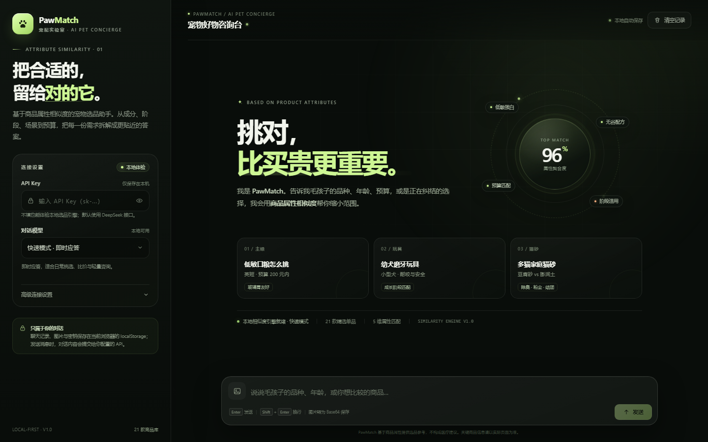

# PawMatch · 宠物智选

一个以「商品属性相似度」为选品核心的宠物 AI 导购单页。无需安装、无需构建、没有后端依赖，双击 `index.html` 即可在浏览器中使用。



## 快速开始

1. 双击 `index.html`（推荐使用最新版 Edge / Chrome）。
2. 不填 API Key 也能直接对话：页面会使用内置的本地选品引擎，从 21 款演示商品中按属性匹配并给出推荐卡片。
3. 想使用真实大模型：在左侧「API Key」中粘贴 DeepSeek API Key，保持默认接口即可。
4. 如果使用其他兼容服务，展开「高级连接设置」，修改接口地址与两个模型的 ID。

## 功能

- **API 配置**：API Key 输入框、显示/隐藏切换、快速模式 / 专家模式下拉菜单。
- **对话界面**：消息输入、发送、停止生成、重新载入历史、清空记录。
- **本地保存**：对话内容、图片、API 配置和模型选择保存在当前浏览器的 `localStorage`，关掉页面再打开仍在。
- **图片消息**：图片上传后会在浏览器内压缩为 WebP，并转为 Base64 随消息保存与展示；支持大图预览、一次最多 4 张。
- **时间显示**：每条消息带发送时间，并按日期分组显示日期分隔线。
- **深色视觉**：响应式布局，桌面侧栏在平板和手机上收进抽屉，支持移动端抽屉、图片灯箱和清空确认。
- **本地体验模式**：21 款宠物商品、5 维加权属性相似度（物种 32% · 品类 29% · 属性 23% · 年龄 8% · 预算 8%），并给出匹配理由与选购提醒。

## API 说明

默认接入 **DeepSeek**（兼容 OpenAI Chat Completions 协议）：

| 设置项 | 默认值 |
| --- | --- |
| API 地址 | `https://api.deepseek.com/chat/completions` |
| 快速模式模型 | `deepseek-chat` |
| 专家模式模型 | `deepseek-reasoner` |

- API Key 只会发送到你配置的接口；聊天、图片和配置只保存在本机浏览器中。
- 页面是纯本地 HTML，API 调用由浏览器直接发出。目标接口必须允许浏览器跨域（CORS）；DeepSeek 的接口支持这种直连方式。如果换成不允许 CORS 的服务，页面会提示连接失败，此时需要改用支持 CORS 的网关或兼容接口。
- DeepSeek 的对话模型是文本模型：图片仍会以 Base64 保存在本地并显示在消息中，但不会作为视觉输入发送给默认模型。改用支持视觉输入的 OpenAI 兼容接口和模型后，图片会按标准 `image_url` 内容数组随请求发送。
- API Key 以明文形式保存在本机 `localStorage`。请勿在公共电脑上保存私人密钥；清除浏览器站点数据会同时清除配置与历史。

## 数据与清除

- 对话记录键：`pawmatch.chat.v1`
- 配置键：`pawmatch.settings.v1`
- 「清空记录」只删除对话与图片，保留 API 与模型设置。
- 单条消息最多附带 4 张图片；浏览器本地存储有容量上限，大量图片可能触发保存提示。

## 文件结构

```text
pawmatch/
├─ index.html   # 单文件应用：样式、交互、本地引擎全部内置
├─ preview.png  # 页面预览
└─ README.md
```

## 说明

- 页面内商品、价格与匹配度为演示数据，实际购买请以商家信息为准。
- 选品建议不构成兽医诊疗建议；持续呕吐、便血、尿闭等异常情况请优先就医。
- 页面不加载外部字体、图标库或图片，因此除 API 请求外可以完全离线使用。
